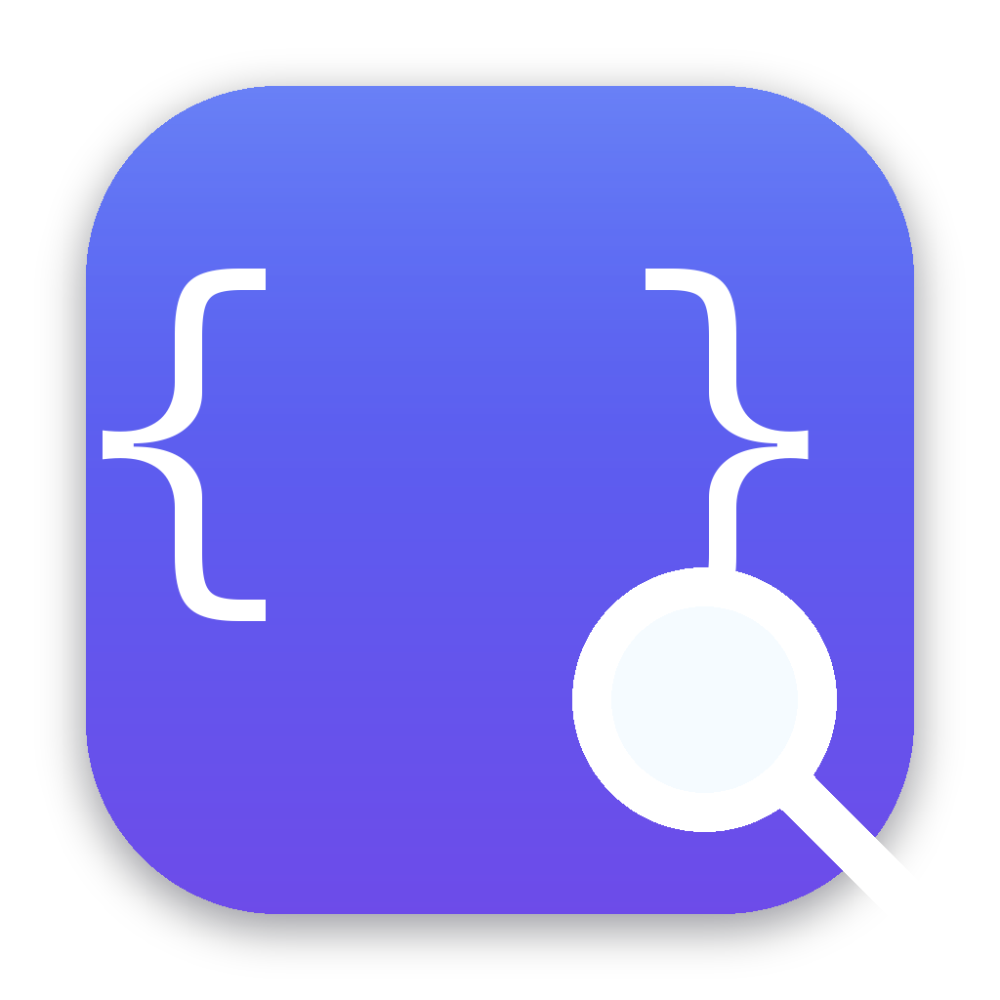
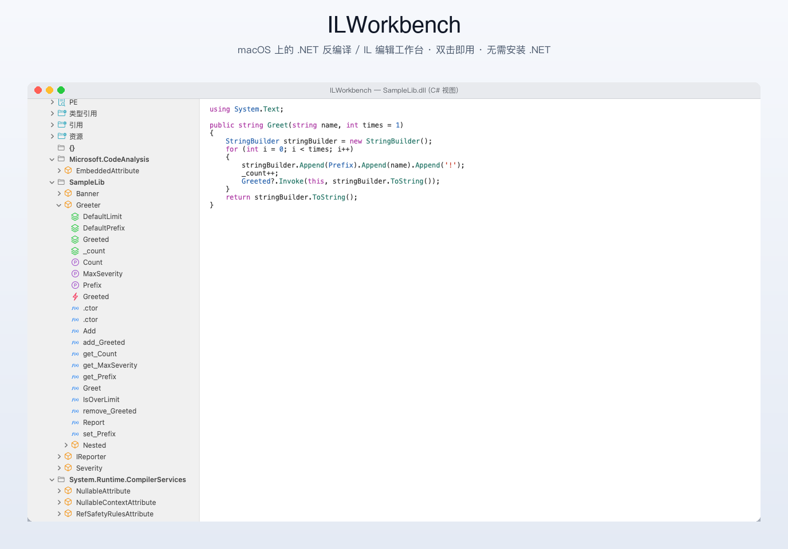
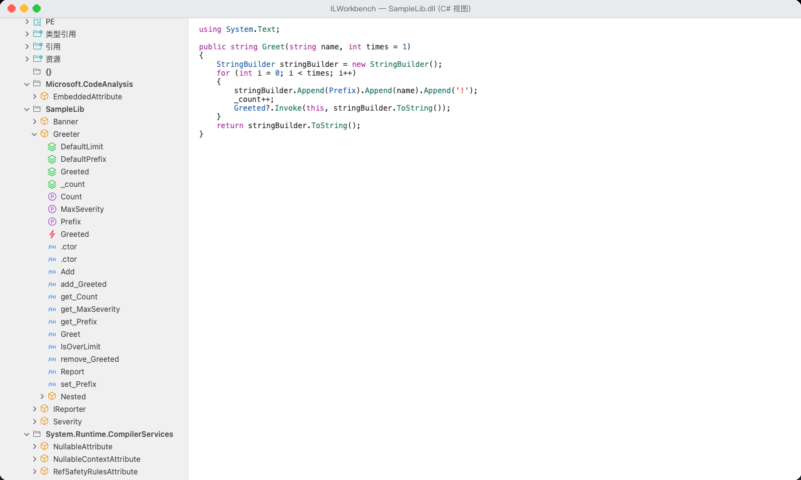
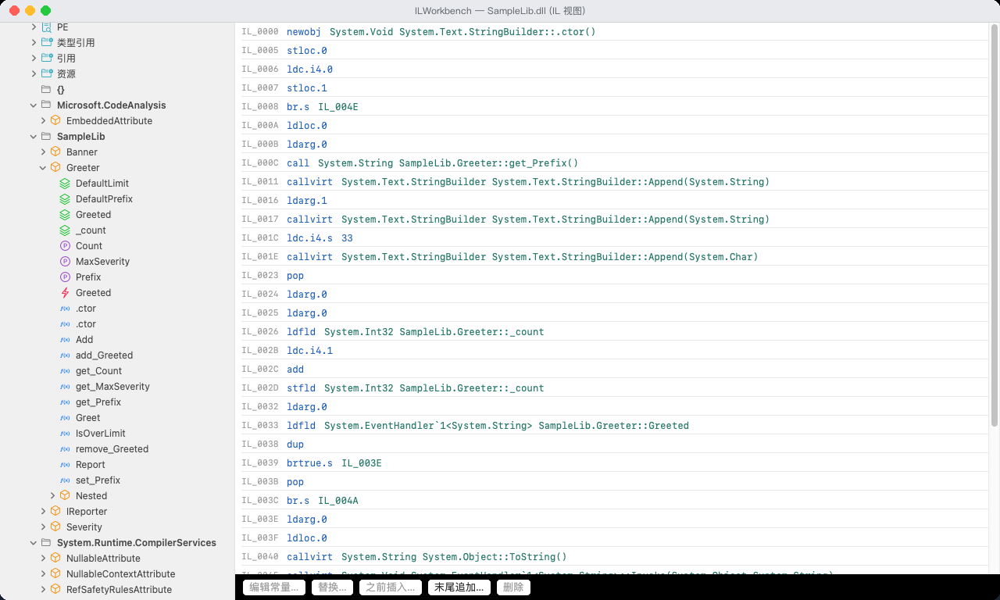
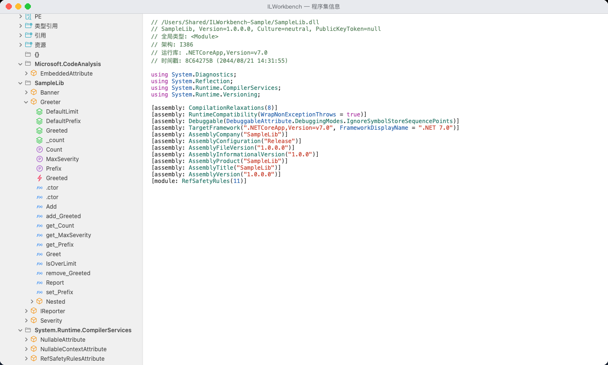
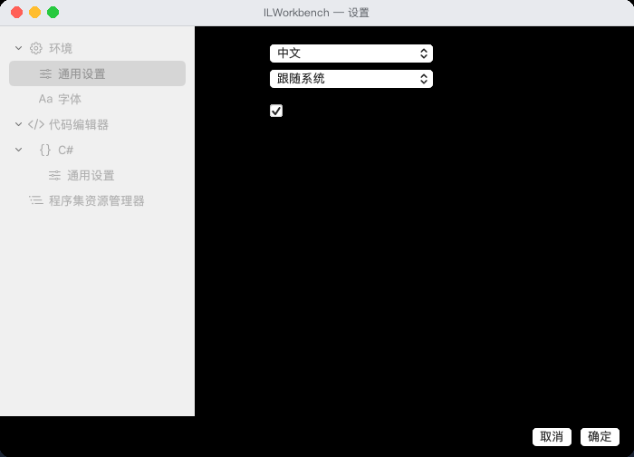

<div align="center">
  
  <h1>ILWorkbench</h1>
  <p><b>A .NET decompiler and IL editor for macOS</b><br>
  Assembly tree · C# decompilation · IL instruction editing · structure editing · save back to the DLL<br>
  Drag the DMG in and go — <b>no .NET installation required</b></p>
  <p><a href="README.md">中文</a> · English</p>
</div>



---

## What it is

A native macOS app: drop a .NET assembly on it and browse namespaces, types, methods and fields the way
dnSpy does, read the decompiled C#, inspect and edit IL instructions, and write the result back to the DLL.

The UI is SwiftUI + AppKit (`NSOutlineView`: real virtualisation, lazy loading, native double-click).
Decompilation and IL editing run in a bundled .NET helper process (dnlib + ICSharpCode.Decompiler).
The helper is published self-contained, so **users do not need .NET installed** — drag it into
Applications and run.

## Features

**Browsing and decompilation**

- Open `.dll` / `.exe` (toolbar, ⌘O, drag onto the window, or `--open <path>`)
- Assembly tree: `assembly → module → PE / Type References / References / Resources / global namespace {} / namespaces`
  - Rows show the bare name with the full signature and token in the tooltip (like dnSpy); both can be
    shown permanently from Settings
  - Lazy loading + virtualisation: a 22k-node assembly expands without stutter
  - `Type References` uses dnSpy's `ShortName @token` format (e.g. `AccessibleRole @010003C0`), generic
    arity rendered as `Action<T1, T2>`
  - `PE` is an expandable tree: `DOS Header / File Header / Optional Header (32-bit) / Section #n /
    Cor20 Header / Storage Signature / Storage Header / Stream #n`, each with a detail report
  - Referenced assemblies are resolved on disk recursively and can be browsed read-only
- Right-click the root node → **Remove Assembly** (⇧⌘W)
- Click the assembly or module row → dnSpy's assembly-info document (path, identity, global type,
  architecture, runtime, timestamp, plus the decompiled `using` directives and `[assembly: …]` attributes)
- C# view with syntax highlighting (hand-written lexer; opens million-character documents instantly)

**IL editing**

- Select a method, switch to `IL`: offset, opcode and operand per instruction, with maxStack and the
  exception-handler count in the footer
- Edit constants (string/number), replace an instruction, insert before, append at the end, delete
- Metadata RIDs are preserved when possible; after deletions the tables are renumbered so no
  `dummy_ptr.{guid}` filler rows are written

**Structure editing**

- Right-click a namespace or type: add field, add method, add type; delete type/member
- Generated method bodies are always valid IL (`return constant` / `return default`), refinable in the IL view
- Interface methods use `MethodSig.CreateInstance` + `HideBySig` to avoid `TypeLoadException` on load

**Interface**

- Switch between Chinese and English — **including tree labels** (`类型引用` / `Type References`,
  `节 #0: .text` / `Section #0: .text`)
- `⌘,` Settings: category tree on the left, page on the right, with **OK / Cancel** (nothing applies until OK)
  - Environment ▸ General: language, theme, allow editing (read-only mode)
  - Environment ▸ Fonts: code/IL font family and size with a live preview
  - Code Editor ▸ C# ▸ General: syntax highlighting, word wrap, tab width
  - Assembly Explorer: hide synthetic members / `[CompilerGenerated]` items, show signatures, show tokens

**Fault tolerance**

Any file can be opened safely: a file that is not a managed assembly becomes an error node (file name +
error icon) whose document explains what was detected.

| Input | Detected as |
|---|---|
| Native Windows DLL/EXE (C/C++, …) | PE header without a CLR header |
| macOS executable / dylib | Mach-O |
| Linux executable / .so | ELF |
| zip / NuGet package | archive |
| Text file / folder | text / folder |
| Managed assembly with damaged metadata | damaged or unsupported metadata |

## Screenshots

**C# view** — tree on the left, decompiled code with syntax highlighting on the right



**IL view** — every instruction of `Greet`, with the editing toolbar



**Assembly info** — shown when the assembly or module row is selected



**Settings** — category tree plus OK / Cancel



## Install (end users)

1. Download `ILWorkbench-x.y.z.dmg` from [Releases](../../releases)
2. Open the DMG and drag **ILWorkbench** into Applications
3. If macOS complains about an unidentified developer: right-click → Open, or
   `xattr -dr com.apple.quarantine /Applications/ILWorkbench.app`

The app is a universal binary (Apple Silicon + Intel) and the helper is self-contained for both
architectures — **no .NET installation required**.

## Build from source

Requirements: macOS 13+, Xcode 15+, .NET 7 SDK.

```bash
git clone https://github.com/<you>/ILWorkbench.git
cd ILWorkbench

Scripts/build-helper.sh
Scripts/publish-helper.sh osx-arm64      # or osx-x64, or both for a universal build

xcodebuild -project ILWorkbench.xcodeproj -scheme ILWorkbench \
  -configuration Release -derivedDataPath build \
  ARCHS="arm64 x86_64" ONLY_ACTIVE_ARCH=NO build

open build/Build/Products/Release/ILWorkbench.app
```

> `Helper/publish/` is a build input of the app: run `publish-helper.sh` first, otherwise the app
> bundle will not contain a helper.

Release disk image:

```bash
Scripts/make-dmg.sh          # writes to dist/
```

Signing and notarisation (optional):

```bash
ILWORKBENCH_SIGN_IDENTITY="Developer ID Application: …" \
ILWORKBENCH_NOTARY_PROFILE="profile-name" Scripts/make-dmg.sh
```

## Diagnostics (no screen-recording permission needed)

The app binary contains its own diagnostics, used by the scripts and CI:

```bash
APP=build/Build/Products/Release/ILWorkbench.app/Contents/MacOS/ILWorkbench
SAMPLE=Samples/SampleLib/bin/Release/net7.0/SampleLib.dll

"$APP" --selftest "$SAMPLE" /tmp/out.dll     # open + decompile + save
"$APP" --ilcheck "$SAMPLE"                   # IL view, assembly document, status pipeline
"$APP" --opentest "$SAMPLE" /bin/ls a.txt    # graceful degradation for non-assemblies
"$APP" --canceltest <big assembly>           # cancellation latency
"$APP" --treesnapshot "$SAMPLE" /tmp/tree.png --expand 类型引用
"$APP" --renderpreview "$SAMPLE" /tmp/code.png --type Greeter
```

End-to-end (IL editing + structure editing + reloading the written assembly with a reflection verifier):

```bash
Scripts/verify.sh
```

## Regenerating the screenshots

```bash
Scripts/make-promo-shots.sh          # uses only the bundled Samples/SampleLib
```

It builds the sample assembly, copies it to `/Users/Shared/ILWorkbench-Sample/` (so no personal
directory shows up in the images), renders the windows into `build/promo-raw/` and composes the final
images in `docs/screenshots/` with `Scripts/compose-promo.py` (needs Python 3 + Pillow; set
`PYTHON=/path/to/python3` to pick an interpreter).

## Repository layout

```
ILWorkbench/            SwiftUI + AppKit front end
Helper/                 .NET helper process (dnlib + ICSharpCode.Decompiler)
Samples/SampleLib/      Sample assembly used by the docs and the verification script
Samples/Verifier/       Reflection verifier that loads what was written back
Scripts/                build, publish, package, verify and screenshot scripts
docs/                   icon and screenshots
```

## How it works

```
SwiftUI front end  ──JSON-RPC (one request per line, loopback TCP, raw BSD sockets)──▶  .NET helper
   NSOutlineView (virtualised, lazy)                                                   dnlib: structure/IL/write
   NSTextView (async highlighting)                                                     ICSharpCode.Decompiler: C#
```

- Requests run on a single worker thread inside the helper (metadata access is not thread-safe),
  while `cancel` is handled on the reader thread, so a long decompilation aborts within a second
- The transport is loopback TCP rather than stdin/stdout: `Process` + `Pipe` on macOS failed to
  deliver child writes back to the parent (see the development notes in the repo history)

## Known limitations

- **Dependency resolution**: assemblies under `References` can only be expanded when they can be found
  next to the file or in system directories; otherwise only the reference row is shown (for example
  .NET Framework system assemblies that do not exist on macOS)
- **Very large types**: first decompilation is engine-bound — a 1.2M-character type takes about 7s
  (cancellable)
- **Viewer/editor only**: no debugger and no disassembler for native binaries
- **macOS 13+ only**; Windows/Linux are not supported
- Unsigned builds trigger a Gatekeeper warning (signing/notarisation is supported via environment variables)

## Credits

- [dnSpy](https://github.com/dnSpy/dnSpy) — the main reference for interaction and information layout
- [ILSpy / ICSharpCode.Decompiler](https://github.com/icsharpcode/ILSpy) — the C# decompilation engine
- [dnlib](https://github.com/0xd4d/dnlib) — assembly reading/writing and IL editing
- [.NET](https://github.com/dotnet/runtime) — the self-contained helper runtime

## License

[MIT](LICENSE). All third-party components are MIT licensed: dnlib, ICSharpCode.Decompiler, .NET Runtime.
